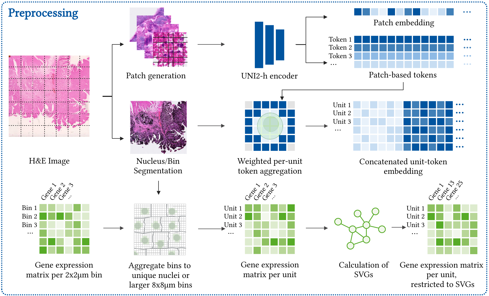

# 01_preprocessing

Turns the raw Visium HD data of each sample into model-ready inputs for the later steps (integration, evaluation).
The data has two modalities, each with its own subfolder:

| Modality | Folder | Raw input | Result |
|---|---|---|---|
| Histology (H&E) | `histology/unimodel/` | whole slide image (WSI) | 224×224 px patches with UNI2-h patch and token embeddings |
| Transcriptomics | `transcriptomics/` | 2 µm / 8 µm bin counts | counts per nucleus (cells) or per 8 µm grid bin, clustered, with spatially variable genes |

Both modalities are linked by a `Patch_ID`: every nucleus / bin is assigned to the histology patch it lies in.



## What is done and why

**Histology**
1. **Patch creation.** We use the WSI as the histological input foundation. 
It is cropped to the Visium frame of recorded transcriptomics (bounds of `tissue_positions.parquet`) and cut into non-overlapping 224×224 px patches. 
Patch positions are stored to link them to the transcriptomics.
2. **Embeddings.** The pretrained UNI2-h model gives one patch embedding (1536-d) and 16×16 token embeddings (14×14 px each) per patch. 
Tokens provide finer spatial resolution than patches.
3. **Background removal.** Patches are clustered (PCA, UMAP, Leiden). 
Clusters without tissue are removed by hand, and the tokens of the remaining patches are kept.
This reduces overhead, even though regions where no transcriptomics are found are also excluded later on.

**Transcriptomics** (two alternative units, both are produced)
- **Cells:** nuclei are segmented on the H&E image using StarDist. 
2 µm bins inside exactly one nucleus are summed per nucleus. 
Quality Control (QC) removes large nuclei (area ≥ 1000 px²) and low counts (UMI ≤ 80).
- **8 µm grid bins:** segmentation-free alternative. 
Native 8 µm bins are used (if provided from the dataset, e.g. from the 10x Genomics sets), or aggregated 4×4 from the 2 µm bins. 
Bins without a patch are dropped, then UMI ≤ 80 is removed.
- **Both:** normalize (target sum 1e4), log1p, 2000 HVGs, PCA, neighbors, Leiden (resolution 0.2). 
Spatially variable genes (SVG) are found with Moran's I (FDR < 0.05, I > 0.1). 
After merging all samples, HVG and SVG are recomputed globally (`var['gene_selection']`) for gene selection later.

## Input data

**UNI2-h weights.** Download `pytorch_model.bin` from Hugging Face (`MahmoodLab/UNI2-h`, login token needed) to `histology/unimodel/weights/`.

**Required layout before any code is run** (`data/` in the repo root, one folder per sample):
```
data/
└── <sample>/                                  e.g. CRC_P1, Normal_P3, CRC_P3_SMAP
    ├── input/
    │   └── <...>_tissue_image.btf             full-resolution H&E (or HE.tif)
    └── output/binned_outputs/
        ├── square_002um/
        │   ├── filtered_feature_bc_matrix.h5
        │   └── spatial/tissue_positions.parquet
        └── square_008um/                      optional, otherwise aggregated from 2 µm
            ├── filtered_feature_bc_matrix.h5
            └── spatial/tissue_positions.parquet
```
Sample folder names are used everywhere as `Slide_ID`. 
Folders other than samples (e.g. `combined`, `new`, `archived`) are skipped or excluded in the code.

**Environments** (`Environments/`): nuclei segmentation needs the StarDist/TensorFlow environment (`nuclei-seg` or `stardist`), everything else uses `autoencoder` (`autoencoders.yml`). 
UNI embeddings need a GPU in practice.

## Outputs

Per sample in `data/<sample>/01_preprocessing/`, merged over all samples in `data/combined/01_preprocessing/` (same structure):
```
unimodel/
├── patches/patch_<N>.png
└── metadata/
    ├── WSI_patch_metadata.csv                  patch positions (X, Y), step 1
    ├── WSI_patch_metadata.h5ad                 patch embeddings
    ├── WSI_patch_token_embeddings.h5ad         token embeddings (per sample only)
    ├── filtered_WSI_patch_embeddings.h5ad      patches with tissue, clusters
    └── WSI_patch_token_embeddings_filtered.h5ad
cell_seg_stardist/002um/
├── polys_FullSection.pckl                      nucleus polygons
└── custom_binning/
    ├── filtered_custom_bins.h5ad               2 µm bins inside one nucleus
    ├── nuclei_grouped_UMI_count.h5ad           raw counts per nucleus
    ├── count_area_filtered_adata.h5ad          QC, clusters, SVG, Patch_ID
    └── nuclei_geometry.parquet                 polygon and centroids
grid_bin/008um/custom_binning/
├── count_area_filtered_adata.h5ad              QC, clusters, SVG, Patch_ID
└── nuclei_grouped_UMI_count.h5ad               raw 8 µm counts, no QC
```

## How to run

Run in this order. Notebooks must be run from their own folder (paths are relative). Scripts can be run from anywhere, from the repo root as below. Steps without a script exist only as notebook.

| # | Step | Notebook | Script |
|---|---|---|---|
| 1 | Patches + patch metadata | `histology/unimodel/notebooks/01_patch_creation_uni.ipynb` | – |
| 2 | Patch and token embeddings | same notebook, last section | `histology/unimodel/notebooks/scripts/01_extract_embeddings.py [--sample X]` |
| 3 | Cluster patches, remove background, filter tokens, merge | `histology/unimodel/notebooks/02_downstream_analysis_uni.ipynb` | – |
| 4 | Nuclei segmentation | – | `histology/unimodel/notebooks/scripts/NucleiSegmentation.py` |
| 5 | Per-sample transcriptomics | `transcriptomics/CustomBinning.ipynb` (cells), `transcriptomics/BinPreprocessing.ipynb` (bins) | `transcriptomics/scripts/preprocess.py --sample X --unit cell\|bin` |
| 6 | Spatially variable genes | `transcriptomics/CustomBinning.ipynb` (cells only, SVG section) | `transcriptomics/scripts/get_svg.py --sample X --unit cell\|bin` |
| 7 | Merge samples, global HVG/SVG | merge cells at the end of both notebooks | – |
| – | Raw 8 µm counts (used in `04_eval`) | – | `transcriptomics/scripts/aggregate_grid_bin_UMI_count.py` |

Notes
- **Order matters.** Step 5 assigns nuclei and bins to patches and needs `filtered_WSI_patch_embeddings.h5ad` from step 3, otherwise patch assignment is skipped. Run step 4 before step 5 for cells.
- **Scripts instead of notebooks** for whole samples: steps 2, 5 and 6 are slow and RAM-heavy on large slides. The notebooks are for exploring cutoffs and plots.
- **Which samples run.** Step 1 and 2 skip the samples in `skip_samples` (`--sample` overrides this in the embedding script). `rerun_full = True` in step 1 deletes and recreates patches and patch metadata.
- **Example commands** (repo root):
```bash
python 01_preprocessing/histology/unimodel/notebooks/scripts/01_extract_embeddings.py --sample CRC_P1

python 01_preprocessing/histology/unimodel/notebooks/scripts/NucleiSegmentation.py \
    -i data/CRC_P1/input/<...>_tissue_image.btf \
    -r1 <row min> -r2 <row max> -c1 <col min> -c2 <col max> \
    -s data/CRC_P1/output/binned_outputs/square_002um \
    -o data/CRC_P1/01_preprocessing/cell_seg_stardist/002um

python 01_preprocessing/transcriptomics/scripts/preprocess.py --sample CRC_P1 --unit cell
python 01_preprocessing/transcriptomics/scripts/get_svg.py --sample CRC_P1 --unit cell
```
