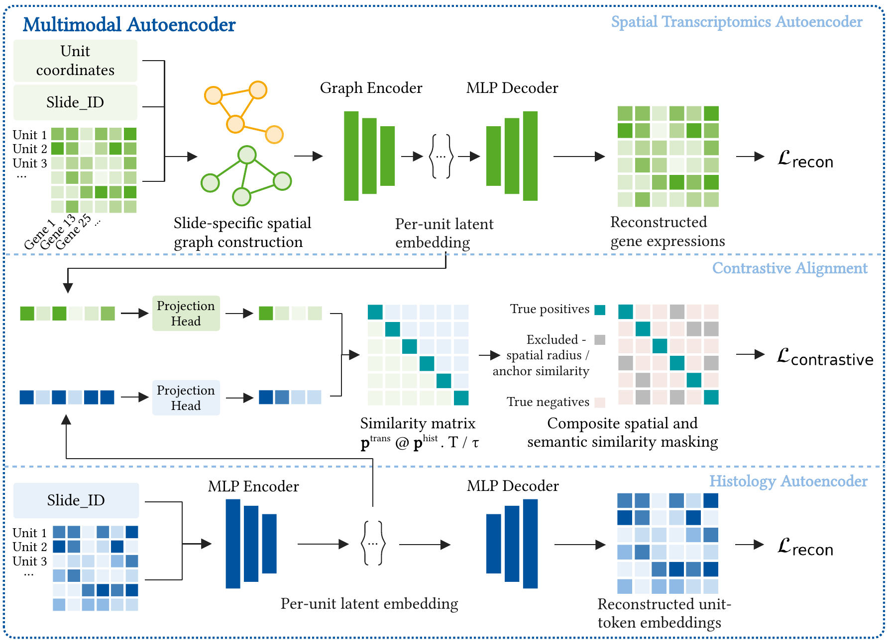

# 03_integration

Trains the joint transcriptomics-histology model (Genomosaic) on the outputs of `01_preprocessing`, and produces
the embeddings `04_eval` evaluates. Two kinds of run, same settings:

| Run | What | Where |
|---|---|---|
| Leave-one-slide-out (LOSO) | one model per held-out slide, the actual generalisation test | `scripts/run_loso.py` |
| Final model | one model trained on the whole cohort, no held-out slide | `scripts/train_final_model.py`, `autoencoder.ipynb` |

| Folder / file | What |
|---|---|
| `autoencoder.ipynb` | interactive: configure + train on all slides step by step, then apply the trained model to a new sample |
| `scripts/` | headless versions for the cluster, plus token distillation and log merging |
| `config/training_config.json` | settings decided after the ablation studies; every script/notebook here reads it |
| `output/` | embeddings of a new, unseen sample (`autoencoder.ipynb`, last section) |



## What is done and why

Each unit (nucleus or 8 µm bin) has two inputs: its own transcriptomics (SVG-selected genes) and the histology
token features `token_preprocessing.py` distilled from `01_preprocessing`'s raw tokens (footprint + halo). A
graph encoder (`trans_enc`, attention over spatial neighbours) and an MLP encoder (`token_enc`) map the two
modalities into a shared latent space. A contrastive loss pulls a unit's transcriptomics and histology embedding
together, against mismatched units of the same slide; each embedding is also decoded back to its own modality
(reconstruction loss), so the latent cannot just collapse onto whichever signal is easiest.

**LOSO.** For 9 held-out slides × 3 gene-set variants (SVG union, Xenium panel, SVG with semantic exclusion) ×
2 units (nuclei, bins), trains on the other slides and reports cell-to-token retrieval and token leakage on the
held-out slide. This is the generalisation result the evaluation chapter is built on.

**Final model.** Same settings, trained on every slide at once, no held-out fold. The deployable model: LOSO
folds exist only to validate generalisation and withhold data on purpose, so none of them is the checkpoint to
actually use afterwards.

**Applying it to a new sample.** Loads a trained final-model checkpoint and encodes a sample outside the
training cohort, no fine-tuning: reuses the checkpoint's own fitted scalers and gene list instead of refitting
on the new sample.

## Input data

Needs `01_preprocessing`'s merged outputs (`data/combined/01_preprocessing/...`) and, per sample, its token file
distilled to per-unit footprint + halo features first:
```bash
python 03_integration/scripts/token_preprocessing.py --unit nuclei --slide CRC_P1
```
(`submit_token_preprocessing.sbatch`, CPU-only). `run_loso.py` and `train_final_model.py` need a GPU in
practice (`--gres=gpu:1` in their sbatch scripts); token distillation does not.

**Environment.** `autoencoder` conda env for everything in this folder.

## Outputs

Written to `data/combined/03_integration/autoencoders/<bin_size>/` (`002um` = nuclei, `008um` = bins):
```
loso_token_log_<slide><tag>.csv             one row per LOSO fold: retrieval, leakage, pretrain metrics
loso_token_checkpoints/
├── loso_token_<slide><tag>.pt              weights, config, scalers, gene names, history
├── loso_token_<slide><tag>_gene_panel.txt
└── loso_token_<slide><tag>_embeddings.npz  train / held-out z_trans, z_token
weights/                                    the final model
├── dual_ae_checkpoint.pt                   weights, config, scalers, gene names, history
├── dual_ae_latents.npz                     z_trans / z_token with unit ids and slide names
├── gene_panel.txt, training_config.json, metrics.json
```
`<tag>` lists only the settings that differ from the reference configuration (`run_tag`).

New-sample embeddings (`autoencoder.ipynb`, last section) go to `03_integration/output/<sample>_<unit>_embeddings.npz`.

## How to run

| Step | What | Script |
|---|---|---|
| 1 | Token distillation, per sample and unit | `scripts/token_preprocessing.py --unit nuclei\|bins --slide X` (`submit_token_preprocessing.sbatch`) |
| 2 | LOSO, all slides × variants × units | `scripts/submit_all_final_loso.sbatch` (drives `submit_run_loso_final.sbatch`) |
| 3 | Merge LOSO logs (optional, any time) | `scripts/merge_loso_logs.py` |
| 4 | Final model | `scripts/train_final_model.py --unit nuclei\|bins` (`submit_train_final_model.sbatch`), or `autoencoder.ipynb` |
| 5 | Apply to a new sample | `autoencoder.ipynb`, last section (needs step 4's `weights/`) |

Notes
- **Settings live in one file.** `config/training_config.json`; `--unit` applies the nuclei/bins preset on top
  of it. Edit the JSON, or override individual flags on `run_loso.py`, rather than duplicating settings elsewhere.
- **Order matters.** A slide's token distillation (step 1) must finish before any training script can use it.
  Step 4 is meant to follow step 2: trust the LOSO result before training the checkpoint you'll actually use,
  since step 4 itself has no held-out slide to check its own settings against.
- **GPU concurrency.** `scripts/manage_night_throttle.sh` raises the LOSO array jobs' concurrency cap at night;
  optional, run it directly on the login node, not via `sbatch`.
- **Example commands** (repo root):
```bash
python 03_integration/scripts/token_preprocessing.py --unit nuclei --slide CRC_P1
python 03_integration/scripts/run_loso.py --held_out_slide CRC_P1
python 03_integration/scripts/train_final_model.py --unit nuclei
```
